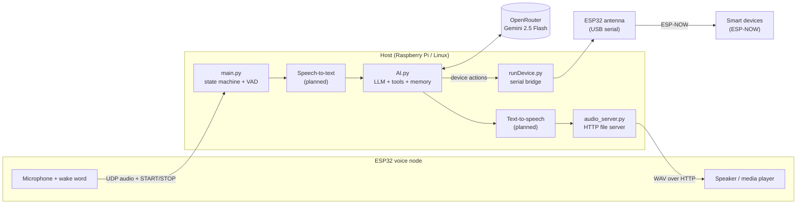

# Self-Hosted Voice-Controlled Smart Home

A privacy-conscious, DIY smart home assistant. Say a wake word to a small ESP32 microphone node, speak naturally, and a local Python server transcribes your request, lets an LLM decide what to do, and switches real devices over ESP-NOW. The assistant also keeps a small long-term memory, so it remembers facts about you between sessions.

> **Status:** work in progress. The ESP32 audio streaming, voice-activity detection, LLM tool calling, persistent memory and device control all work on their own. The speech-to-text and text-to-speech stages that join them into one hands-free loop are still being built (see the [Roadmap](#roadmap)).

---

## Features

- **Hands-free voice input.** An ESP32 node detects the wake word and streams 16 kHz mono audio to the server over UDP.
- **Smart endpointing.** WebRTC VAD (most aggressive mode) detects when you stop talking and tells the ESP32 to close the stream, so there is no push-to-talk.
- **LLM tool calling.** Gemini 2.5 Flash, accessed through [OpenRouter](https://openrouter.ai), decides when to control a device, save a memory or just chat. The model can be swapped with one line.
- **Persistent memory.** The assistant stores and forgets key/value facts in `memory.json`, capped at 25 entries. The model prunes the least relevant one when the bank is full.
- **Short-term conversation history.** The last 20 messages are kept and expire after 30 minutes of inactivity.
- **Wireless device control.** A USB-attached ESP32 "antenna" bridges the host to devices using ESP-NOW, so there is no Wi-Fi setup, cloud or hub per device.
- **Alternative trigger: double snap.** `eavesdropper.py` detects a double finger-snap by analysing the 15–20 kHz band with an FFT. However false positives are common using this method.
- **Built-in audio hosting.** A tiny HTTP server serves generated speech WAV files to the ESP32's media player.

## Architecture



### How a request flows

1. The ESP32 hears the wake word and sends `START`, then streams raw audio (16 kHz, 16-bit, mono PCM) to UDP port 5000.
2. `main.py` slices the stream into 30 ms frames and runs each through WebRTC VAD. After 1.5 s of silence it sends `STOP` back to the ESP32. The ESP32 also enforces its own 15 s timeout.
3. The captured audio is transcribed to text (STT stage, planned).
4. `AI.py` sends the text, the recent chat history and the memory bank to the LLM along with the tool definitions from `AITools.json`.
5. The model replies with one or more tool calls:
   - `trigger_smart_home` switches a device and includes a short `spoken_response`.
   - `save_memory` / `delete_memory` manage the long-term memory bank.
6. Device actions are sent over USB serial to the ESP32 antenna as `MAC|CODE`, and the antenna forwards them to the target device over ESP-NOW.
7. The spoken reply is synthesised to a WAV in `audio_output/` and played by the ESP32 (TTS stage, planned).

## Project structure

```
.
├── main.py                 # Orchestrator: UDP listener, VAD, system state machine
├── AI.py                   # LLM client, tool handling, chat history, memory
├── audio_server.py         # HTTP server for speech WAV files (serves ./audio_output)
├── runDevice.py            # CLI: sends one ESP-NOW command through the USB antenna
├── eavesdropper.py         # Double-snap detector (alternative wake trigger)
├── AITools.json            # Tool/function schemas exposed to the LLM
├── memory.json             # Long-term memory bank (max 25 entries)
├── chatHistory.json        # Rolling short-term history (auto-generated)
├── audio_output/           # Generated speech files (auto-created)
├── ESP32Antenna/
│   └── lib/Protocol/
│       └── Protocol.json   # Device MAC addresses and command codes (shared with firmware)
└── .env                    # OPENROUTER_API_KEY (not committed)
```

### System states

`main.py` is built around a small state machine:

| State | Meaning |
|---|---|
| `IDLE` | Waiting for the wake word |
| `LISTENING` | Receiving UDP audio, running VAD |
| `INPUT_READY` | Recording finished, ready for STT |
| `THINKING_SPEAKING` | LLM is responding while speech is generated and played |
| `SHUTDOWN` | Hardware failsafe triggered |

## Hardware

- **Host:** Raspberry Pi or any Linux machine (the serial port defaults to `/dev/ttyACM0`)
- **Voice node:** ESP32 with a microphone, speaker and wake-word firmware, streaming to the host over Wi-Fi
- **Antenna:** ESP32 connected over USB, running the ESP-NOW bridge firmware (`ESP32Antenna/`), which reads `MAC|CODE\n` lines from serial
- **Devices:** ESP32-based switches, for example the corner lamp
- **Microphone (optional):** USB mic on the host for the double-snap trigger

## Getting started

### Prerequisites

- Python 3.10+
- An [OpenRouter](https://openrouter.ai) API key
- The ESP32 voice node and antenna flashed and on your network
- On Debian/Ubuntu/Raspberry Pi OS, PyAudio needs PortAudio: `sudo apt install portaudio19-dev`

### Installation

```bash
git clone <your-repo-url>
cd <your-repo-name>

python -m venv .venv
source .venv/bin/activate

pip install openrouter python-dotenv pyserial numpy pyaudio webrtcvad
```

### Configuration

1. Create a `.env` file in the project root:

   ```env
   OPENROUTER_API_KEY=your_key_here
   ```

2. Create an empty memory file:

   ```bash
   echo "{}" > memory.json
   ```

3. Fill in `ESP32Antenna/lib/Protocol/Protocol.json` with your device MAC addresses and command codes, for example `MAC_CORNER_LAMP`, `CODE_TURN_ON` and `CODE_TURN_OFF`.

4. Check the serial port in `runDevice.py` (`PORT = '/dev/ttyACM0'`) and the antenna's baud rate (`115200`).

### Running

```bash
# Test the LLM + device control from the terminal
python AI.py

# Send a raw command to a device through the antenna
python runDevice.py <MAC_ADDRESS> <COMMAND_CODE>

# Tune and test the double-snap detector
python eavesdropper.py

# Start the voice pipeline (UDP listener + VAD + audio server)
python main.py
```

### Ports

| Port | Protocol | Purpose |
|---|---|---|
| 5000 | UDP | Audio stream and control messages from the ESP32 |
| 5000 | TCP/HTTP | Serves generated WAV files to the ESP32 |

## Configuration reference

| Setting | File | Default | Description |
|---|---|---|---|
| `MODEL` | `AI.py` | `google/gemini-2.5-flash` | Any OpenRouter model that supports tool calling |
| `HISTORY_TTL` | `AI.py` | `1800` s | Chat history expires after this much inactivity |
| `HISTORY_MAX` | `AI.py` | `20` | Messages kept in short-term history |
| Memory limit | `AI.py` | `25` entries | Enforced through the system prompt |
| `vad.set_mode()` | `main.py` | `3` | VAD aggressiveness (0–3) |
| `MAX_SILENCE_FRAMES` | `main.py` | `50` (1.5 s) | Silence before the stream is closed |
| `VOLUME_THRESHOLD` | `eavesdropper.py` | `20000` | Snap sensitivity, needs tuning per mic |
| `MIN/MAX_TIME_WINDOW` | `eavesdropper.py` | `0.2 / 0.8` s | Allowed gap between the two snaps |

## Adding a new device

1. Add its MAC address and command codes to `Protocol.json`.
2. Add the new `action_id` values (for example `desk_power_on`) to the `trigger_smart_home` schema in `AITools.json`.
3. Add a matching branch to `execAction()` in `AI.py`.
4. Flash the device firmware so it understands the same command codes.

## Roadmap

- [x] ESP32 to host UDP audio streaming
- [x] Voice-activity detection and automatic end-of-speech
- [x] LLM tool calling with Gemini 2.5 Flash via OpenRouter
- [x] Persistent key/value memory and rolling chat history
- [x] ESP-NOW device control through a USB antenna
- [x] Double-snap trigger prototype
- [ ] Speech-to-text stage (save WAV, transcribe)
- [ ] Stream LLM output sentence by sentence into TTS and play it back on the ESP32
- [ ] Barge-in: interrupt the assistant mid-sentence and clear the ESP32 media queue
- [ ] Replace `subprocess` calls with in-process threaded device control
- [ ] Desk power control
- [ ] Hardware failsafe handling (`SHUTDOWN`)
- [ ] Wire the snap trigger into the main pipeline

## Tech stack

Python · WebRTC VAD · NumPy (FFT) · PyAudio · PySerial · OpenRouter API · Gemini 2.5 Flash · ESP32 · ESP-NOW · UDP/HTTP networking

## License

Add a license of your choice (for example MIT) before publishing.
